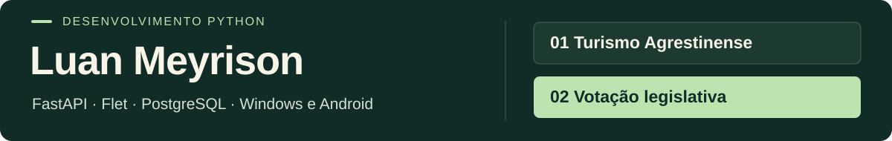

## Projetos em destaque

| [01 · Turismo Agrestinense →](projetos/turismo-agrestinense.md) | [02 · Votação da Câmara →](projetos/votacao-legislativa.md) |
| :--- | :--- |
| **Aplicativo do visitante + administração + backend.** Mapas, roteiros, guia de áudio e passaporte digital. | **Sessões + votos + sincronização.** Preparação, abertura e encerramento de votações, com consultas para painéis e dispositivos. |
| Python · Flet · FastAPI · Android/Kotlin | Python · FastAPI · PostgreSQL |

### Sistemas para Mulher, Agricultura e Meio Ambiente

Três projetos com fluxos específicos de gestão:

| Projeto | Escopo | Conheça |
| :--- | :--- | :--- |
| **Secretaria da Mulher** | Triagens, encaminhamentos, acompanhamento e relatórios | [Ficha do projeto →](projetos/secretaria-da-mulher.md) |
| **Secretaria de Agricultura** | Gerenciamento Rural Cloud: pedidos, status, consultas por módulo e relatórios | [Ficha e versões →](projetos/secretaria-de-agricultura.md) |
| **Secretaria de Meio Ambiente** | Gestão de atividades, cronogramas, cadastros e ações formativas | [Ficha e versão →](projetos/secretaria-de-meio-ambiente.md) |

**Em foco:** transformar rotinas de cada área em fluxos de software, com validação, controle de acesso e organização dos dados.

### Outras frentes

- **Gestão de Gabinete:** aplicação Python/Flet para Windows e Android, com agenda, lembretes e integração com API em Google Apps Script.
- **SaaS de atendimento por WhatsApp:** backend com autenticação, consultas de conversas e operações de atendimento, utilizando FastAPI e SQLAlchemy.

> As fichas acima são públicas e podem ser lidas sem acesso aos repositórios de implementação. Código, credenciais e dados operacionais dos projetos privados permanecem restritos.

## Sobre meu trabalho

Sou **Luan Meyrison**, desenvolvedor Python. Trabalho na conexão entre interfaces para **Windows e Android**, APIs e bancos de dados, com projetos em turismo, gestão legislativa e serviços públicos.

Meu foco está na experiência de quem usa e nas regras que sustentam o sistema: autenticação, fluxos de trabalho, sincronização, persistência e documentos.

## Competências técnicas

| Frente | Tecnologias presentes nos projetos |
| :--- | :--- |
| **Aplicações e interfaces** | Python, Flet, Windows e Android |
| **Backend e integrações** | FastAPI, Pydantic, HTTPX, Requests e Google Apps Script |
| **Persistência** | PostgreSQL, SQLAlchemy e SQLite |
| **Identidade e sessão** | JWT, integração de login Google e estado separado por usuário |
| **Documentos e distribuição** | ReportLab, documentos PDF, APKs, executáveis e GitHub Releases |

Os projetos de Turismo também incluem integração nativa Android em Kotlin. Essas tecnologias representam o conjunto do portfólio; cada ficha informa o escopo correspondente.

## Oportunidades

Estou aberto a oportunidades em **desenvolvimento Python, backend, frontend e full stack**, especialmente em aplicações que conectem interfaces, serviços e dados.

**Para uma conversa técnica:** integração aplicativo–API, modelagem de fluxos, autenticação, sincronização por usuário, geração de documentos e distribuição de aplicações.

---

## English

I develop Python applications with Flet interfaces, FastAPI services and database integrations. My portfolio includes **Turismo Agrestinense**, a **legislative voting system**, and management systems for **Women's Affairs, Agriculture and Environment**.

My work spans Windows and Android applications, API integration, authentication, state synchronization and document generation. Public project briefs describe the scope while private source code and operational data remain restricted.

Open to **Python, backend, frontend and full-stack opportunities**.

<strong>Luan Meyrison</strong> · Da interface às regras do sistema.

