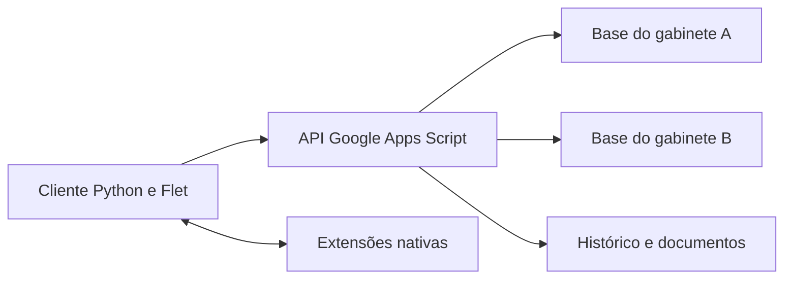

# Gestão de Gabinete

**Documentação técnica | Aplicações Windows e Android e API Google Apps Script**

[Perfil profissional](https://github.com/meyrison) | [Índice da documentação](README.md)

## Objetivo

Organizar demandas, pedidos, agenda e documentos de gabinetes em uma aplicação desktop e mobile. O projeto inclui cliente Python/Flet, API em Google Apps Script, extensões nativas e testes.

## Funcionalidades

- Pedidos, demandas, agenda e lembretes.
- Ofícios com editor, assinatura e documentos online.
- Resultados, indicadores e relatórios.
- Sincronização, paginação e atualização incremental por registro.
- Backup com arquivos e hashes e restauração de anexos.
- Separação de bases por gabinete.
- Integração Android com notificações e desbloqueio biométrico, quando compatível.

## Arquitetura



O cliente negocia os recursos disponíveis na versão da API. A documentação das versões 3.4.0 e 3.4.1 descreve proteção contra sobrescrita concorrente e comportamento quando o servidor ainda usa protocolo anterior. Cliente e API devem ser homologados como um conjunto.

## Tecnologias e estrutura

| Elemento | Implementação |
| :--- | :--- |
| Cliente | Python 3.12 e Flet 0.86.5 |
| Documentos | ReportLab, Pillow e QR Code |
| Backend | JavaScript em Google Apps Script |
| Recursos nativos | Extensões Flet/Flutter e integração Android |
| Entrada e módulos | `main.py` e `src/` |
| API | `google_apps_script/Code.gs` e `appsscript.json` |
| Extensões | `extensions/` |
| Build e testes | `pyproject.toml`, `requirements*.txt`, `tests/` e `tools/` |

## Requisitos e execução

Na raiz dos fontes autorizados, utilize Python 3.12 e o launcher do projeto:

```powershell
.\INICIAR.bat
```

O launcher prepara o cliente nativo com as extensões locais. Executar `python main.py` com um cliente Flet genérico não garante os controles personalizados do editor.

Para gerar as distribuições:

```powershell
# Windows
.\GERAR_EXE.bat
# Android
.\GERAR_APK.bat
```

A compilação Windows requer as ferramentas do Flutter e do Visual Studio para aplicativos Windows. Para Android, consulte `LEIA_PRIMEIRO_APK.txt` no projeto autorizado para Java, SDK e arquiteturas.

## Configuração da API

Os bancos e a autenticação são configurados nas **Script Properties** do projeto Apps Script. Para testes, use uma implantação e bases próprias. Ao atualizar uma implantação existente, preserve a URL e os valores de configuração necessários; não substitua um ambiente operacional para testar o portfólio.

Não são publicados neste documento identificadores de bancos, senhas, endereços internos, timbres, assinaturas ou dados dos documentos.

## Testes disponíveis

```powershell
python -m pip install -r requirements.txt
python -m unittest discover -s tests -v
node tests/test_apps_script_audit.cjs
```

As regressões documentadas utilizam dados descartáveis e simuladores dos serviços Google. Os testes Flutter das extensões nativas são executados na pasta da extensão, com `flutter pub get` e `flutter test`.

## Limites de homologação

Sincronização, restauração de anexos, controle de conflitos, assinatura e biometria exigem cenários próprios de integração. Os testes locais não substituem aparelho Android físico ou conferência da implantação online. As versões de cliente e API possuem numerações próprias.

## Verificação e acesso

Documentação conferida com os fontes e manifestos em 09/11/2026. Esta revisão foi documental: não executou serviços, migrações, testes funcionais ou cargas de produção. Os fontes são privados; valores de configuração, credenciais e dados operacionais foram omitidos.
