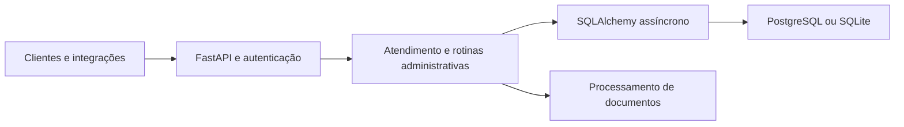

# SaaS de atendimento e automação

**Documentação técnica | Backend de atendimento, interações e documentos**

[Perfil profissional](https://github.com/meyrison) | [Índice da documentação](README.md)

## Objetivo

Disponibilizar um backend para atendimento e rotinas administrativas, com empresas, clientes, interações, tarefas, faturas, aprovações e processamento de documentos. O projeto também declara contratos de webhook para WhatsApp e e-mail e operações relacionadas a agentes de atendimento.

## Uso comercial e operação em nuvem

O projeto é atualmente alugado para prefeituras municipais, em modelo de locação de software, com operação em nuvem.

O backend e os serviços configurados compõem a operação em nuvem. A ativação de canais externos, provedores de IA e filas depende da configuração de cada ambiente.

## Funcionalidades

- Autenticação, usuário atual, dashboard e relatórios.
- Empresas, clientes, produtos, serviços e base de conhecimento.
- Registro e consulta de interações e conversas.
- Tarefas, faturas e fluxo de aprovações.
- Auditoria e processamento de documentos.
- Operações de agentes de atendimento e financeiro.
- Contratos de integração para WhatsApp e e-mail.

Os contratos de integração estão presentes no backend; canais externos, provedores de IA e processamento em fila requerem configuração própria em cada implantação.

## Arquitetura



A entrada ASGI é `api:app`. O módulo concentra modelos, regras de domínio e rotas. A persistência utiliza SQLAlchemy assíncrono; a escolha de banco e os fallbacks dependem da configuração.

## Tecnologias e estrutura

| Área | Recursos identificados |
| :--- | :--- |
| API | Python, FastAPI, Uvicorn e Pydantic |
| Persistência | SQLAlchemy, asyncpg e aiosqlite |
| Autenticação | PyJWT |
| Integrações HTTP | HTTPX |
| Documentos | pdfplumber, PyPDF2, Pillow e pytesseract |
| Dependências adicionais | Celery, Redis e bibliotecas LangChain |
| Fontes | `api.py` e `requirements.txt` |

Celery e Redis estão listados nas dependências; a topologia de workers não é detalhada nesta documentação. A utilização de OCR requer também os componentes externos compatíveis do Tesseract.

## Configuração

| Variável | Finalidade |
| :--- | :--- |
| `DATABASE_URL` | URL de conexão do banco |
| `JWT_SECRET` | Segredo de autenticação; o código também consulta `SECRET_KEY` |
| `APP_ENV` | Identificação do ambiente |
| `CORS_ORIGINS` | Origens autorizadas |
| `FD_USE_POSTGRES`, `FD_FORCE_SQLITE`, `FD_DISABLE_DB_FALLBACK` | Seleção e política de fallback do banco |
| `FD_DATA_DIR`, `FD_UPLOAD_DIR` | Armazenamento de dados e uploads |
| `REDIS_URL` | Integração Redis, quando utilizada |

Use dados fictícios, diretórios descartáveis e serviços próprios de testes. Confira a seleção efetiva do banco: não presuma uso de PostgreSQL apenas pela existência de uma URL.

## Instalação e execução local

### Preparar o ambiente

Para a equipe com acesso aos fontes, execute na raiz do backend. O exemplo usa Python 3.12 como ambiente de referência; as dependências estão em `requirements.txt`. Confirme as versões homologadas antes de reproduzir uma implantação.

```powershell
py -3.12 -m venv .venv
.\.venv\Scripts\python.exe -m pip install -r requirements.txt
```

### Configurar e executar

Defina **DATABASE_URL** com a conexão de um banco de testes e **JWT_SECRET** com um segredo exclusivo desse ambiente. Configure também as integrações utilizadas antes de inicializar. Não use valores padrão nem uma base operacional para demonstrações.

```powershell
if (-not $env:DATABASE_URL -or -not $env:JWT_SECRET) {
    throw "Configure o banco de testes e o segredo de autenticação."
}
.\.venv\Scripts\python.exe -m uvicorn api:app --host 127.0.0.1 --port 8000
```

A API fica disponível em `http://127.0.0.1:8000`. A interface OpenAPI padrão do FastAPI pode ser consultada em `/docs`; ela descreve o contrato da versão efetivamente iniciada.


Configure o driver e os seletores de banco de acordo com a implantação desejada. Não conecte webhooks reais durante uma demonstração e não envie documentos operacionais para provedores externos sem autorização.

## Validação técnica

Não foi localizada suíte automatizada versionada. A homologação deve verificar: autenticação, permissões entre empresas, operações de clientes e interações, transições de aprovação, consistência de faturas, limites de upload e tratamento de falhas das integrações.

Endpoints de simulação não substituem a validação do canal WhatsApp. Filas, agentes, OCR e serviços externos exigem configuração e testes específicos.

## Verificação e acesso

Documentação técnica conferida com os fontes e manifestos em 09/11/2026. O modelo de locação para prefeituras municipais e o uso atual em nuvem foram informados pelo autor. A revisão documental não incluiu auditoria dos ambientes dos clientes nem execução de serviços, migrações ou testes de produção. Fontes, credenciais e dados operacionais permanecem privados.
