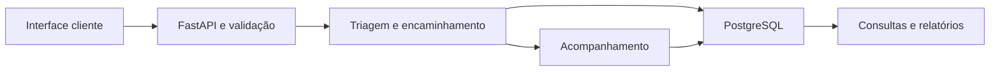

# Sistema da Secretaria da Mulher

**Documentação técnica | Triagens, encaminhamentos e acompanhamento**

[Perfil profissional](https://github.com/meyrison) | [Índice da documentação](README.md)

## Objetivo

Organizar fluxos de atendimento por meio de triagens, encaminhamentos, acompanhamento e relatórios. A documentação descreve o backend identificado nos fontes, sem reproduzir fichas reais ou dados de pessoas atendidas.

## Uso comercial e operação em nuvem

O projeto é atualmente alugado para prefeituras municipais, em modelo de locação de software, com operação em nuvem.

Os serviços de gestão e persistência integram a operação em nuvem. As informações de atendimento permanecem nos ambientes autorizados; este documento apresenta somente o escopo técnico.

## Funcionalidades

- Registro e consulta de triagens.
- Criação e atualização de encaminhamentos.
- Atualização de acompanhamento e movimentações.
- Gestão de usuários e permissões.
- Importação de cadastros.
- Consultas e relatórios por período e módulo.

## Arquitetura e dados



O backend concentra contratos Pydantic, autenticação e operações de persistência em `api.py`. Os modelos incluem triagem, encaminhamento, acompanhamento, usuário e atualização de status. O frontend não está descrito como uma implementação independente nesta ficha.

## Tecnologias e estrutura

| Área | Recursos identificados |
| :--- | :--- |
| API | Python, FastAPI, Uvicorn e Pydantic |
| Banco | PostgreSQL e psycopg2 |
| Autenticação | JWT e bibliotecas de senha |
| Documentos | ReportLab, python-docx e bibliotecas PDF |
| Configuração | python-dotenv e leitura de variáveis de ambiente |
| Fontes | `api.py`, `requirements.txt` e pacotes de distribuição interna |

## Configuração

| Parâmetro | Finalidade |
| :--- | :--- |
| `URL_NUVEM` | DSN de conexão PostgreSQL; não é o endereço HTTP da API |
| `SECRET_KEY` | Segredo de autenticação do ambiente |
| Configuração administrativa | Provisionamento de contas autorizadas, fora da documentação pública |
| Configuração SMTP, quando utilizada | Envio de mensagens ou backups, com conta de testes |

Revise a configuração interna antes de iniciar: não use valores padrão para autenticação ou conexão. Banco, contas e serviços devem pertencer ao ambiente de testes.

## Instalação e execução local

### Preparar o ambiente

Para a equipe com acesso aos fontes, execute na raiz do backend. O exemplo usa Python 3.12 como ambiente de referência; as dependências estão em `requirements.txt`. Confirme as versões homologadas antes de reproduzir uma implantação.

```powershell
py -3.12 -m venv .venv
.\.venv\Scripts\python.exe -m pip install -r requirements.txt
```

### Configurar e executar

Defina **URL_NUVEM** com a conexão de um banco de testes e **SECRET_KEY** com um segredo exclusivo desse ambiente. Configure também as integrações utilizadas antes de inicializar. Não use valores padrão nem uma base operacional para demonstrações.

```powershell
if (-not $env:URL_NUVEM -or -not $env:SECRET_KEY) {
    throw "Configure o banco de testes e o segredo de autenticação."
}
.\.venv\Scripts\python.exe -m uvicorn api:app --host 127.0.0.1 --port 8000
```

A API fica disponível em `http://127.0.0.1:8000`. A interface OpenAPI padrão do FastAPI pode ser consultada em `/docs`; ela descreve o contrato da versão efetivamente iniciada.


## Fluxo de utilização

1. Usuário autorizado autentica-se na aplicação.
2. O cliente envia uma triagem ou consulta um registro permitido.
3. O fluxo pode gerar encaminhamento e atualizações de acompanhamento.
4. Consultas e relatórios apresentam os registros disponíveis ao usuário.

## Validação e privacidade

Não foi localizada suíte automatizada no repositório consultado. A homologação deve cobrir validação dos formulários, permissões entre usuários, evolução de status, relatórios e importações com dados fictícios.

O sistema trata informações pessoais e de atendimento. Demonstrações, logs, fixtures e documentação pública devem usar dados sintéticos e não reproduzir documentos ou bancos operacionais. A existência de autenticação no código não equivale a certificação de segurança ou conformidade.

## Verificação e acesso

Documentação técnica conferida com os fontes e manifestos em 09/11/2026. O modelo de locação para prefeituras municipais e o uso atual em nuvem foram informados pelo autor. A revisão documental não incluiu auditoria dos ambientes dos clientes nem execução de serviços, migrações ou testes de produção. Fontes, credenciais e dados operacionais permanecem privados.
