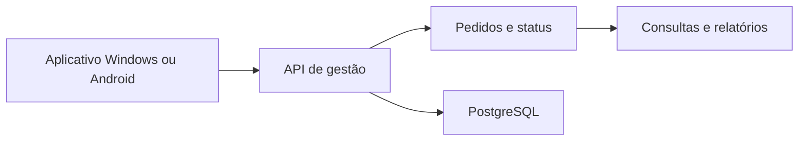

# Secretaria de Agricultura · Gerenciamento Rural Cloud

**Gestão rural · Windows · Android · Backend**

[Voltar ao portfólio](../README.md)

## O projeto

Sistema de gestão rural apresentado no portfólio como projeto da Secretaria de Agricultura. Reúne uma API e distribuições do aplicativo para Windows e Android.

## Escopo funcional

- Registro, consulta e edição de pedidos.
- Atualização de status e listagem por módulo.
- Gestão de usuários e autenticação.
- Importação de cadastros.
- Relatórios por período.

## Tecnologias

**Python, Flet, FastAPI, PostgreSQL, Pydantic, JWT e ferramentas para documentos.**

## Distribuições públicas

| Plataforma | Repositório | Versões |
| :--- | :--- | :--- |
| Windows | [Gerenciamento Rural Cloud](https://github.com/meyrison/Gerenciamento-Rural-Cloud) | [EXE e notas](https://github.com/meyrison/Gerenciamento-Rural-Cloud/releases/latest) |
| Android | [Gerenciamento Rural Cloud · Android](https://github.com/meyrison/Gerenciamento-Rural-Cloud-v4.2.0) | [APK e notas](https://github.com/meyrison/Gerenciamento-Rural-Cloud-v4.2.0/releases/latest) |

As notas publicadas incluem evolução da interface de login no Windows e manutenção do fluxo de atualização no Android.

## Aspectos técnicos

- Integração entre aplicações e API.
- Modelagem de pedidos e transições de status.
- Consultas por módulo e geração de relatórios.
- Distribuição e evolução de versões desktop e mobile.

## Escopo desta apresentação

Os instaladores são públicos; a implementação do backend permanece privada. Esta revisão verificou os arquivos de implementação e as releases, sem executar os aplicativos ou medir desempenho.

---

**English:** Rural management system with request workflows, status updates, reporting and Windows/Android distributions.
