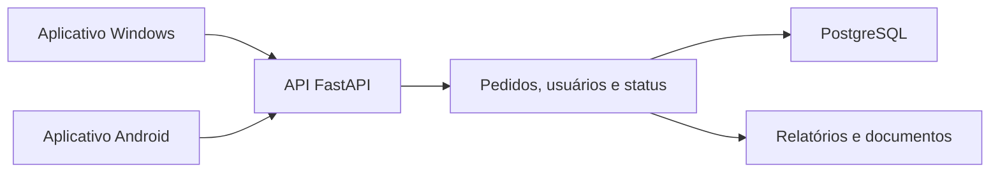

# Secretaria de Agricultura — Gerenciamento Rural Cloud

**Documentação técnica | Aplicações Windows e Android e backend**

[Perfil profissional](https://github.com/meyrison) | [Índice da documentação](README.md)

## Objetivo

Apoiar a gestão rural com registro e acompanhamento de pedidos, consultas por módulo, cadastros e relatórios. O projeto é apresentado como sistema da Secretaria de Agricultura, com uma API privada e distribuições públicas para Windows e Android.

## Uso comercial e operação em nuvem

O projeto é atualmente alugado para prefeituras municipais, em modelo de locação de software, com operação em nuvem.

Os aplicativos Windows e Android se conectam ao backend em nuvem. Os instaladores são os clientes do sistema e não representam toda a infraestrutura necessária à operação.

## Funcionalidades

- Registro, consulta, edição e exclusão de pedidos.
- Atualização de status e listagem por módulo.
- Gestão de usuários e autenticação.
- Importação de cadastros.
- Relatórios por período.
- Distribuição e atualização dos aplicativos.

## Arquitetura



A API declara `app` em `api.py`. As distribuições dos clientes ficam em repositórios próprios. O arquivo de dependências do backend inclui também bibliotecas de interface; ele não substitui um projeto completo de build dos clientes.

## Tecnologias e estrutura

| Área | Recursos |
| :--- | :--- |
| Interfaces | Python e Flet; distribuições Windows e Android |
| Backend | FastAPI, Uvicorn, Pydantic e Gunicorn nas dependências |
| Banco | PostgreSQL e psycopg2 |
| Autenticação | JWT e bibliotecas de senha |
| Documentos | ReportLab, python-docx e pypdf |
| Fontes da API | `api.py` e `requirements.txt` |

Os contratos incluem pedido, usuário, atualização de status e importação de cadastros. As regras concretas de cada módulo pertencem à implementação autorizada.

## Configuração

| Parâmetro | Finalidade |
| :--- | :--- |
| `URL_NUVEM` | DSN PostgreSQL do ambiente; não é a URL HTTP da aplicação |
| `SECRET_KEY` | Segredo para autenticação |
| Configuração administrativa | Provisionamento de contas e permissões |
| SMTP, quando utilizado | Serviços de envio e backup do ambiente |

Revise a configuração interna antes de inicializar para evitar conexões com bancos operacionais ou uso de valores padrão.

## Instalação e execução do backend

### Preparar o ambiente

Para a equipe com acesso aos fontes, execute na raiz do backend. O exemplo usa Python 3.12 como ambiente de referência; as dependências estão em `requirements.txt`. Confirme as versões homologadas antes de reproduzir uma implantação.

```powershell
py -3.12 -m venv .venv
.\.venv\Scripts\python.exe -m pip install -r requirements.txt
```

### Configurar e executar

Defina **URL_NUVEM** com a conexão de um banco de testes e **SECRET_KEY** com um segredo exclusivo desse ambiente. Configure também as integrações utilizadas antes de inicializar. Não use valores padrão nem uma base operacional para demonstrações.

```powershell
if (-not $env:URL_NUVEM -or -not $env:SECRET_KEY) {
    throw "Configure o banco de testes e o segredo de autenticação."
}
.\.venv\Scripts\python.exe -m uvicorn api:app --host 127.0.0.1 --port 8000
```

A API fica disponível em `http://127.0.0.1:8000`. A interface OpenAPI padrão do FastAPI pode ser consultada em `/docs`; ela descreve o contrato da versão efetivamente iniciada.


## Aplicativos e distribuição

| Plataforma | Canal público |
| :--- | :--- |
| Windows | [Executável e notas de versão](https://github.com/meyrison/Gerenciamento-Rural-Cloud/releases/latest) |
| Android | [APK e notas de versão](https://github.com/meyrison/Gerenciamento-Rural-Cloud-v4.2.0/releases/latest) |

O canal Android possui identificadores históricos divergentes entre tag, título e notas. Eles foram preservados para não invalidar links de distribuição. Esta ficha não infere um número único de versão a partir desses rótulos.

Não foi identificado um roteiro de build completo dos clientes nos repositórios de distribuição. Não é correto prometer geração de APK ou EXE apenas com os arquivos públicos.

## Validação técnica

Não foi localizada suíte automatizada no repositório da API. Homologue em banco de testes: autenticação, pedido com dados válidos e inválidos, edição, mudança de status, consulta por módulo e relatório do mesmo período. Teste atualização do cliente e recuperação de falhas de conexão separadamente.

## Verificação e acesso

Documentação técnica conferida com os fontes e manifestos em 09/11/2026. O modelo de locação para prefeituras municipais e o uso atual em nuvem foram informados pelo autor. A revisão documental não incluiu auditoria dos ambientes dos clientes nem execução de serviços, migrações ou testes de produção. Fontes, credenciais e dados operacionais permanecem privados.
