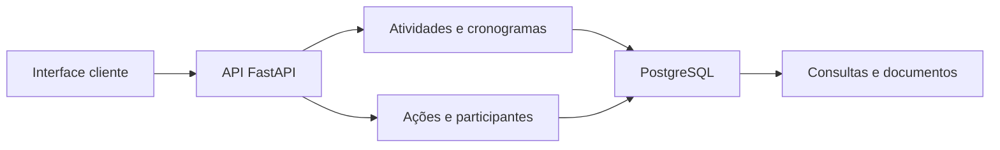

# Sistema da Secretaria de Meio Ambiente

**Documentação técnica | Atividades, cronogramas e ações formativas**

[Perfil profissional](https://github.com/meyrison) | [Índice da documentação](README.md)

## Objetivo

Organizar atividades, cadastros, cronogramas e ações formativas da Secretaria de Meio Ambiente. A documentação descreve o backend de gestão e sua relação com o canal público de distribuição.

## Funcionalidades

- Cadastro, edição e atualização de status de atividades.
- Organização de cronogramas semanais, com publicação e rascunho.
- Catálogo formativo, ações e participantes.
- Importação de cadastros e participantes.
- Consultas por módulo e geração de documentos.
- Gestão de usuários e autenticação.

## Arquitetura



A implementação consultada concentra rotas, modelos de entrada e persistência em `api.py`. Os modelos incluem atividade, semana do cronograma, ação formativa, participantes e importação de planilhas.

## Tecnologias e estrutura

| Área | Recursos |
| :--- | :--- |
| Backend | Python, FastAPI, Uvicorn e Pydantic |
| Banco de dados | PostgreSQL e psycopg2 |
| Autenticação | JWT e bibliotecas de senha |
| Relatórios | ReportLab, python-docx, pypdf e openpyxl |
| Configuração | python-dotenv e variáveis de ambiente |
| Fontes principais | `api.py`, `requirements.txt` e pacotes internos |

## Configuração

| Parâmetro | Finalidade |
| :--- | :--- |
| `URL_NUVEM` | DSN PostgreSQL; não é o endereço HTTP da API |
| `SECRET_KEY` | Segredo de autenticação |
| Configuração administrativa | Contas e acesso aos módulos |
| SMTP, quando utilizado | Serviços de envio do ambiente |

Antes de inicializar, revise os parâmetros internos, configure um banco descartável e mantenha as integrações separadas da produção.

## Instalação e execução do backend

### Preparar o ambiente

Para a equipe com acesso aos fontes, execute na raiz do backend. O exemplo usa Python 3.12 como ambiente de referência; as dependências estão em `requirements.txt`, sem garantia de compatibilidade decorrente desta revisão.

```powershell
py -3.12 -m venv .venv
.\.venv\Scripts\python.exe -m pip install -r requirements.txt
```

### Configurar e executar

Defina **URL_NUVEM** com a conexão de um banco de testes e **SECRET_KEY** com um segredo exclusivo desse ambiente. Configure também as integrações utilizadas antes de inicializar. Não use valores padrão nem uma base operacional para demonstrações.

```powershell
if (-not $env:URL_NUVEM -or -not $env:SECRET_KEY) {
    throw "Configure o banco de testes e o segredo de autenticação."
}
.\.venv\Scripts\python.exe -m uvicorn api:app --host 127.0.0.1 --port 8000
```

A API fica disponível em `http://127.0.0.1:8000`. A interface OpenAPI padrão do FastAPI pode ser consultada em `/docs`; ela descreve o contrato da versão efetivamente iniciada.


## Distribuição

O [canal público de distribuição](https://github.com/meyrison/Update-APK-e-EXE-da-Sec-De-Meio-Amiente) disponibiliza uma [release Windows 1.3.7](https://github.com/meyrison/Update-APK-e-EXE-da-Sec-De-Meio-Amiente/releases/tag/1.3.7), com executável e manifesto JSON.

O backend pode evoluir independentemente desse instalador. Esta documentação não presume que todas as funcionalidades atuais estejam na versão pública 1.3.7. Não há um processo completo de compilação dos clientes documentado no canal público.

## Validação técnica

Não foi localizada suíte automatizada no repositório consultado. A homologação deve incluir criação e edição de atividade, transição entre rascunho e publicação, vínculo de participantes, importação de planilhas e conferência dos documentos gerados. Use cadastros fictícios e verifique permissões antes de disponibilizar consultas.

## Verificação e acesso

Documentação conferida com os fontes e manifestos em 09/11/2026. Esta revisão foi documental: não executou serviços, migrações, testes funcionais ou cargas de produção. Os fontes são privados; valores de configuração, credenciais e dados operacionais foram omitidos.
