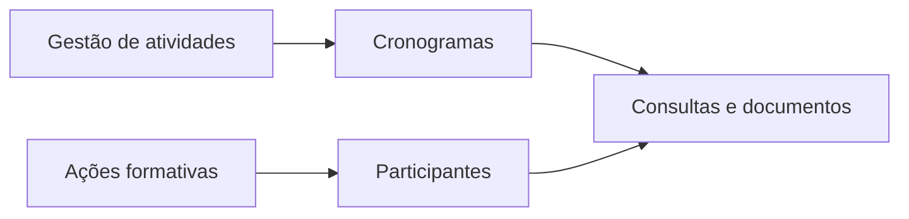

# Sistema da Secretaria de Meio Ambiente

**Gestão de atividades · Cronogramas · Cadastros · Ações formativas**

[← Voltar ao portfólio](../README.md)

## O projeto

Sistema para organizar atividades e informações da Secretaria de Meio Ambiente. O escopo identificado no backend inclui cronogramas, cadastros, catálogo formativo e consultas por módulo.

## Escopo funcional

- Cadastro e atualização de atividades.
- Organização de cronogramas semanais, com publicação e rascunho.
- Cadastro de ações formativas e participantes.
- Importação de cadastros e participantes.
- Consultas por módulo e geração de documentos de participantes.
- Gestão de usuários e autenticação.

## Tecnologias

**Python, FastAPI, Pydantic, PostgreSQL, JWT, ReportLab e ferramentas para planilhas e documentos.**

## Distribuição pública

[Conhecer o canal de distribuição](https://github.com/meyrison/Update-APK-e-EXE-da-Sec-De-Meio-Amiente) · [Consultar a release 1.3.7](https://github.com/meyrison/Update-APK-e-EXE-da-Sec-De-Meio-Amiente/releases/tag/1.3.7)

O canal público disponibiliza uma versão Windows. O escopo do backend descrito nesta ficha pode evoluir independentemente dessa release.

## Pontos para uma entrevista técnica

- Organização de fluxos semanais e estados de publicação.
- Relação entre ações formativas e participantes.
- Importação, consulta e geração de documentos a partir de dados estruturados.

## Escopo desta apresentação

A ficha combina a identificação do projeto confirmada pelo autor com as funcionalidades encontradas no backend. O código e os dados operacionais permanecem privados. Esta revisão não executou o sistema em ambiente real.

---

**English:** Environmental management backend covering activities, weekly schedules, training initiatives, participants and document generation.
