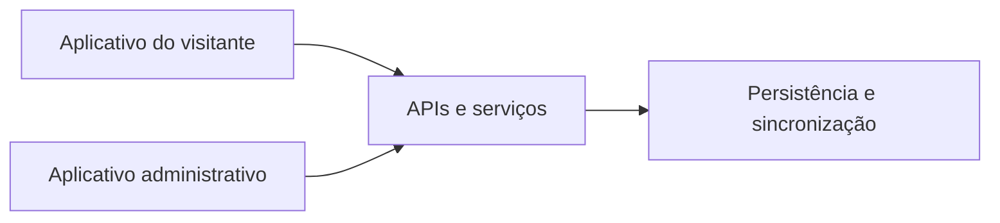

# Turismo Agrestinense

**Turismo digital · Aplicativo do visitante · Administração · Backend**

[Voltar ao portfólio](../README.md)

## O projeto

Ecossistema de software voltado à descoberta turística de Agrestina. Reúne um aplicativo para o visitante, um aplicativo administrativo e um backend, com responsabilidades próprias.

## Componentes e funcionalidades

| Componente | Escopo encontrado no projeto |
| :--- | :--- |
| Aplicativo do visitante | Descoberta, mapas, roteiros, guia de áudio, passaporte digital e perfil |
| Administração | Notícias, busca e filtros, editor, fotos, áudio, prévia de publicação e rascunhos por usuário |
| Backend e serviços | Autenticação, sessões, sincronização de dados e integração com serviços externos |
| Integração Android | Ponte nativa para login Google, notificações, navegação e compartilhamento |

O diagrama resume os componentes; os aplicativos utilizam serviços com contratos próprios.

## Tecnologias

**Python, Flet, FastAPI, HTTPX, Pydantic, SQLite, Google Apps Script e integração Android em Kotlin.**

## Aspectos técnicos

- Separação entre experiência do visitante, administração e serviços.
- Persistência de rascunhos e estado por usuário.
- Comunicação entre Python e recursos nativos Android.
- Sincronização e recuperação de estado na troca de conta.

## Escopo desta apresentação

Ficha elaborada a partir da estrutura, dependências e documentação dos projetos. Os fontes permanecem privados. Há integração Apple no backend, mas sua ativação depende de configuração externa; ela não é apresentada aqui como recurso operacional.

Esta ficha não representa uma nova execução dos testes nem validação em aparelho físico.

---

**English:** Tourism software ecosystem with visitor and administration applications, authentication services, synchronization and Android native integration.
