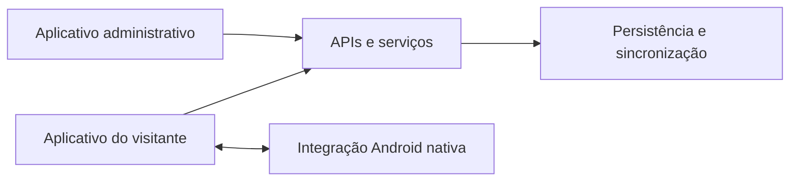

# Turismo Agrestinense

**Documentação técnica | Aplicativo, administração e backend**

[Perfil profissional](https://github.com/meyrison) | [Índice da documentação](README.md)

## Objetivo

Reunir descoberta turística, conteúdo editorial e jornada do visitante em um ecossistema com três componentes: aplicativo do visitante, aplicativo administrativo e backend. O projeto contempla interfaces Python/Flet, recursos Android nativos e serviços de autenticação e sincronização.

## Uso comercial e operação em nuvem

O projeto é atualmente alugado para prefeituras municipais, em modelo de locação de software, com operação em nuvem.

Os aplicativos do visitante e da administração acessam serviços em nuvem. Recursos nativos e parte do estado local continuam no dispositivo; operação em nuvem não significa que toda a interface seja executada no servidor.

## Funcionalidades

| Componente | Responsabilidades |
| :--- | :--- |
| Visitante | Descoberta de lugares, mapas, roteiros, guia de áudio, passaporte digital, perfil e jornada |
| Administração | Notícias, busca, filtros, editor, fotos, áudio, prévia de publicação e rascunhos por usuário |
| Backend | Identidade, sessões, sincronização, serviços de roteiros, feedback e telemetria |
| Android nativo | Integração com login Google, notificações, navegação e compartilhamento |

## Arquitetura e fluxo de dados



Os clientes utilizam contratos próprios com o backend e com serviços Google Apps Script. Não se trata de uma única API compartilhada por todas as operações. O estado local e os rascunhos são separados por usuário.

## Tecnologias e organização

| Área | Tecnologias e arquivos |
| :--- | :--- |
| Interfaces | Python 3.12, Flet 0.86.5, módulos `app_*.py` e `main.py` |
| Android | Kotlin, ponte JNI e template em `native/flet-template/` |
| Backend | FastAPI, Pydantic e HTTPX; entrada em `app/main.py` |
| Persistência | SQLite no backend; armazenamento local nos clientes |
| Integrações | Login Google, Google Apps Script, mapas e recursos nativos |
| Contratos e serviços | `app/models.py`, `app/services/`, `app/security/` |
| Configuração | `pyproject.toml`, `requirements*.txt`, `app/config.py` e `render.yaml` |

## Requisitos e execução

### Aplicativo do visitante

Na raiz dos fontes autorizados, use Python **3.12**. O manifesto declara `>=3.12,<3.13`.

```powershell
.\ABRIR_APP.cmd
```

O launcher prepara o ambiente. Para gerar o APK:

```powershell
.\GERAR_APK.cmd
```

A configuração Android usa ARM64, Android mínimo API 24 e template nativo próprio. A compilação depende de Flutter, Java e Android SDK/NDK. Configure e preserve a chave de assinatura de distribuição.

### Aplicativo administrativo

O componente administrativo também usa Python 3.12 e seus próprios `ABRIR_APP.cmd` e `GERAR_APK.cmd`. Execute os comandos na pasta desse componente. O login e as permissões dependem do serviço configurado; não há acesso administrativo público de demonstração.

### Backend

Na raiz do backend:

```powershell
py -3.12 -m venv .venv
.\.venv\Scripts\python.exe -m pip install -r requirements.txt
# Configure banco de testes, segredo de sessão e integrações antes de iniciar.
.\.venv\Scripts\python.exe -m uvicorn app.main:app --host 127.0.0.1 --port 8000
```

| Configuração | Finalidade |
| :--- | :--- |
| `DATABASE_URL` | Localização da base de dados do ambiente |
| `SESSION_SECRET` | Assinatura dos tokens/sessões |
| `SESSION_TTL_SECONDS`, `REFRESH_TTL_SECONDS` | Duração das sessões e renovação |
| `APPLE_CLIENT_ID`, `APPLE_REDIRECT_URI` e configuração de chave | Integração Apple, quando habilitada |
| `AI_PROVIDER`, `AI_MODEL`, `AI_API_KEY` | Serviço de IA, quando configurado |
| `ROUTES_PROVIDER`, `ROUTES_BASE_URL` | Serviço de roteiros |

No cliente, `BACKEND_URL` identifica a API configurada. Valores reais e chaves devem permanecer fora do portfólio e do Git.

## Contratos de integração

O backend declara operações para login Google, renovação e encerramento de sessão, consulta do usuário e sincronização. O cliente envia sua autorização nas operações protegidas. A existência da integração Apple no código não comprova sua ativação: ela exige conta e configuração externas.

## Testes disponíveis

No aplicativo do visitante, com as dependências de desenvolvimento instaladas:

```powershell
.\.venv\Scripts\python.exe -m pip install -r requirements-dev.txt
.\.venv\Scripts\python.exe tests/run.py
.\.venv\Scripts\python.exe VALIDAR_V130.py
.\.venv\Scripts\ruff.exe check .
```

No componente administrativo:

```powershell
.\.venv\Scripts\python.exe -m unittest discover -s tests -v
```

A documentação existente descreve testes com armazenamento temporário e serviços simulados. Câmera, GPS, notificações, login nativo e assinatura exigem validação em aparelho físico.

## Limites operacionais

O manifesto de referência do backend inclui SQLite e uma configuração de armazenamento temporário no Render. Essa configuração versionada não descreve, por si só, a infraestrutura atual dos clientes. Ao reproduzi-la em um novo ambiente, confirme persistência e backup: armazenamento temporário pode perder dados após reinícios e deployments. Builds com assinatura de teste não substituem instalações assinadas com outra chave.

## Verificação e acesso

Documentação técnica conferida com os fontes e manifestos em 09/11/2026. O modelo de locação para prefeituras municipais e o uso atual em nuvem foram informados pelo autor. A revisão documental não incluiu auditoria dos ambientes dos clientes nem execução de serviços, migrações ou testes de produção. Fontes, credenciais e dados operacionais permanecem privados.
