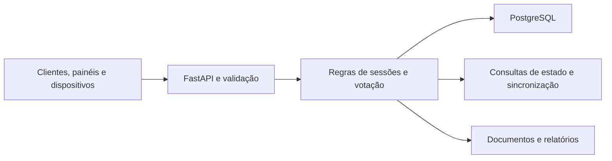

# Sistema de votação legislativa

**Documentação técnica | Câmara dos Vereadores**

[Perfil profissional](https://github.com/meyrison) | [Índice da documentação](README.md)

## Objetivo

Disponibilizar um backend para organizar sessões legislativas, documentos e votações, com registro de votos e consulta de estado por painéis e dispositivos. O escopo consultado é a implementação da API; não inclui os fontes de uma interface de plenário.

## Funcionalidades

- Cadastro, consulta e atualização de sessões e documentos.
- Preparação de votações, incluindo operações em lote.
- Apresentação, abertura e encerramento da votação.
- Registro de votos e consultas do estado ativo.
- Sincronização de eventos e acompanhamento de dispositivos.
- Usuários, gabinetes, protocolos e relatórios.

## Arquitetura



A aplicação ASGI é `app`, declarada em `api.py`. O código inclui pool de conexões PostgreSQL e configurações de timeout. Consultas de estado e sincronização são recursos de API; não há evidência aqui de transporte WebSocket nem de latência garantida.

## Tecnologias e estrutura

| Elemento | Implementação |
| :--- | :--- |
| API | Python, FastAPI, Uvicorn e Pydantic |
| Banco relacional | PostgreSQL, psycopg2 e pool de conexões |
| Identidade | JWT e dependências de validação de credenciais |
| Documentos | ReportLab, python-docx, bibliotecas PDF e openpyxl |
| Fontes principais | `api.py` e `requirements.txt` |

## Modelo funcional

O código declara modelos para **sessão, votação, voto, documento, protocolo, gabinete e usuário**. Uma votação possui operações de transição; os clientes devem consultar o estado vigente, tratar rejeições da API e não considerar uma operação concluída somente pelo envio da requisição.

## Configuração

| Variável | Finalidade |
| :--- | :--- |
| `DATABASE_URL` | DSN PostgreSQL do ambiente |
| `SECRET_KEY` | Segredo de autenticação |
| `ACCESS_TOKEN_EXPIRE_MINUTES` | Expiração dos tokens |
| `API_CORS_ORIGINS` | Origens web autorizadas |
| `DB_POOL_MIN`, `DB_POOL_MAX` | Limites do pool |
| `DB_CONNECT_TIMEOUT`, `DB_STATEMENT_TIMEOUT_MS` | Limites de conexão e execução |

Configurações administrativas e de backup são internas e devem ser fornecidas pela equipe responsável. Não reutilize credenciais operacionais em uma demonstração.

## Instalação e execução local

### Preparar o ambiente

Para a equipe com acesso aos fontes, execute na raiz do backend. O exemplo usa Python 3.12 como ambiente de referência; as dependências estão em `requirements.txt`, sem garantia de compatibilidade decorrente desta revisão.

```powershell
py -3.12 -m venv .venv
.\.venv\Scripts\python.exe -m pip install -r requirements.txt
```

### Configurar e executar

Defina **DATABASE_URL** com a conexão de um banco de testes e **SECRET_KEY** com um segredo exclusivo desse ambiente. Configure também as integrações utilizadas antes de inicializar. Não use valores padrão nem uma base operacional para demonstrações.

```powershell
if (-not $env:DATABASE_URL -or -not $env:SECRET_KEY) {
    throw "Configure o banco de testes e o segredo de autenticação."
}
.\.venv\Scripts\python.exe -m uvicorn api:app --host 127.0.0.1 --port 8000
```

A API fica disponível em `http://127.0.0.1:8000`. A interface OpenAPI padrão do FastAPI pode ser consultada em `/docs`; ela descreve o contrato da versão efetivamente iniciada.


## Validação técnica

Não foi localizada uma suíte automatizada no repositório consultado. Antes de homologar, valide em banco descartável: criação de sessão, preparação de votação, abertura, voto autorizado, encerramento, consulta pelos dispositivos e rejeição de operações incompatíveis com o estado. Verifique também isolamento de permissões e falhas de conexão.

Desempenho em plenário, concorrência e recuperação de dispositivos exigem testes de integração e carga próprios; os parâmetros de pool e cache não comprovam capacidade de atendimento.

## Verificação e acesso

Documentação conferida com os fontes e manifestos em 09/11/2026. Esta revisão foi documental: não executou serviços, migrações, testes funcionais ou cargas de produção. Os fontes são privados; valores de configuração, credenciais e dados operacionais foram omitidos.
