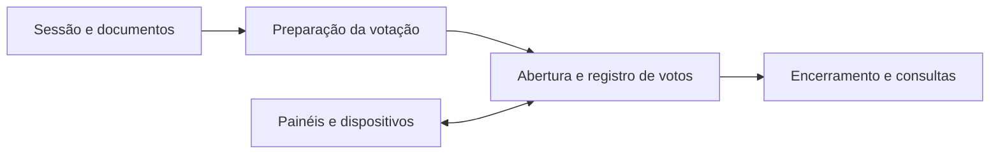

# Votação da Câmara dos Vereadores

**Gestão legislativa · Sessões · Votação · Sincronização**

[Voltar ao portfólio](../README.md)

## O projeto

Sistema com backend para organizar sessões legislativas, documentos e fluxos de votação. A API inclui operações para preparar, apresentar, abrir e encerrar votações, além de registrar votos e disponibilizar o estado para painéis e dispositivos.

## Escopo funcional

- Cadastro e consulta de sessões e documentos.
- Preparação de votações, incluindo operações em lote.
- Transições de estado da votação.
- Registro de votos e consultas de acompanhamento.
- Integração de dispositivos com consulta de estado e sincronização de eventos.
- Operações de usuários, gabinetes, protocolos e relatórios.

O diagrama apresenta o fluxo funcional, sem reproduzir contratos internos.

## Tecnologias

**Python, FastAPI, Pydantic, PostgreSQL, psycopg2, JWT e ferramentas para documentos PDF e Office.**

## Aspectos técnicos

- Como representar o ciclo de vida de uma votação.
- Como integrar consultas de dispositivos ao estado persistido.
- Como organizar permissões e operações administrativas.
- Como manter documentos e sessões relacionados no backend.

## Escopo desta apresentação

As funcionalidades descritas foram identificadas nos modelos e operações da API. O código-fonte permanece privado. Esta ficha não certifica disponibilidade, desempenho em plenário ou comportamento sob carga.

---

**English:** Legislative backend covering sessions, documents, voting workflows, vote registration and device synchronization.
